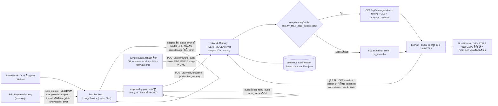
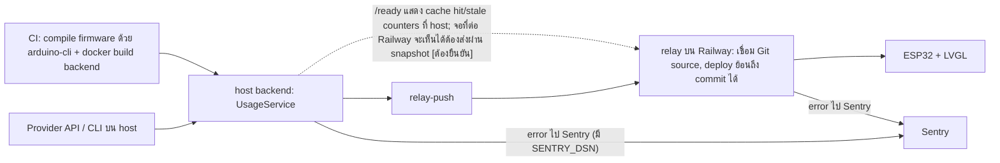

# 01 — Business process (As-Is / To-Be)

platform-ai-usage-display คืออุปกรณ์ส่วนตัวของ owner คนเดียว: backend (TypeScript/Node) รวมการใช้งานและโควตา subscription ของ Claude, Codex, Grok, Kimi, Gemini แล้วส่งให้จอ ESP32 (320x240) ผ่าน `GET /api/ai-usage` โดย provider key อยู่เฉพาะบน host และ relay บน Railway ถือ snapshot ที่ host push ไป (ใน memory) และไฟล์ OTA firmware (ใน volume)

Last reviewed: 2026-11-28 · commit `51a910e`

## As-Is (จากโค้ดวันนี้)

Sources: `backend/src/server.ts`, `backend/src/lib/usage-service.ts`, `backend/src/routes/relay.ts`, `backend/scripts/relay-push.mjs`, `firmware/esp32-lvgl/esp32-lvgl.ino`, `docs/hosted-relay.md`, `PRODUCT.md`

ข้อเท็จจริงจากโค้ด/เอกสาร:

- relay ไม่ถือ provider credential และเก็บ snapshot ใน memory เท่านั้น; หลัง restart จอเป็น OFFLINE จนกว่า pusher ส่งรอบถัดไป ส่วนไฟล์ OTA อยู่ใน Railway volume `/data/firmware` (ย้าย deploy ต้องรักษา volume ไม่งั้น OTA ตอบ 404 จนกว่าจะ publish ใหม่) (`docs/hosted-relay.md`)
- OTA ที่ดาวน์โหลดไม่ครบหรือ MD5/size ผิด จะไม่ flash (ยังรัน firmware เดิม); ไม่มี rollback อัตโนมัติ (`PRODUCT.md` §Limits)
- service บน Railway ไม่มี Git source: push เข้า `main` ไม่ deploy และบอกไม่ได้ว่ารัน commit ใด (`PRODUCT.md`) [ต้องยืนยัน: สถานะปัจจุบันของ deployment]
- Sentry เป็น no-op จนกว่าจะตั้ง `SENTRY_DSN` (ยังไม่ตั้ง ตาม `PRODUCT.md`) [ต้องยืนยัน]

## To-Be (`PRODUCT.md` §Status และ `docs/UPGRADE-PLAN.md` §Backlog)

Sources: `PRODUCT.md`, `docs/UPGRADE-PLAN.md`

## Gap

| ID | As-Is → To-Be | Status | Owner | Evidence |
|---|---|---|---|---|
| G1 | Railway service ไม่มี Git source (deploy ด้วย CLI upload) → เชื่อม repo เพื่อให้ deploy ย้อนถึง commit (ทางเลือก) | todo | owner | `PRODUCT.md` §Status (owner action) |
| G2 | ไม่ตั้ง `SENTRY_DSN` (error reporter เป็น no-op) → ตั้งบน Railway แล้ว redeploy (host ตั้งเมื่อต้องการ) | todo | owner | `PRODUCT.md` §Status; `backend/src/sentry.ts` |
| G3 | CI ไม่ compile firmware (ตรวจแค่ว่า `secrets.h` ไม่ถูก commit) → compile ด้วย arduino-cli | todo | claude | `docs/UPGRADE-PLAN.md` §P0; `.github/workflows/backend-ci.yml` |
| G4 | `subscription-quotas.ts` ยังรวม Claude/Codex/Grok (630 บรรทัด) → แยกเป็น module ต่อ provider + test ของ Kimi refresh | todo | claude | `docs/UPGRADE-PLAN.md` §P1 |
| G5 | ไม่มี docker build ใน CI และ `/ready` ไม่แสดง cache counters → เพิ่มทั้งสอง | todo | claude | `docs/UPGRADE-PLAN.md` §P2 |

## Open questions

- relay ที่ Railway รัน commit ไหนอยู่ตอนนี้ (บันทึกไม่ได้เพราะไม่มี Git source)
